# AI Video Editor + Cloud Media Pipeline: System Design Diagram Set

**Legend (all diagrams)**

- Solid arrow `-->` = synchronous request/response. Dashed arrow `-.->` = asynchronous / event / queue.
- Colour coding: blue = browser-side, green = backend services, amber = workers, purple = storage/data, pink = AI, grey = external systems.
- "Decision Point" = an architectural choice intentionally left open.
- C4 is drawn with Mermaid flowcharts and subgraphs (more reliable than Mermaid's experimental C4 syntax).

---

## 1. C4 System Context

**Purpose:** Who and what the system interacts with, at the outermost boundary.

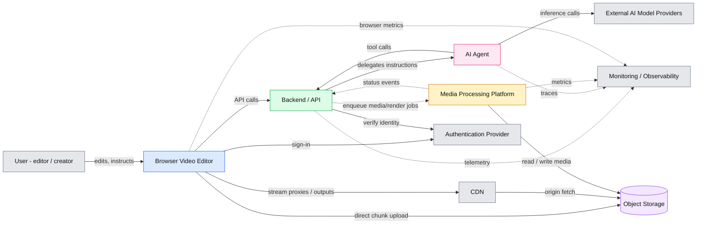

**Key entities:** User, Browser Editor, Backend/API, AI Agent, Media Processing Platform, Object Storage, CDN, Auth provider, AI providers, Observability.

**Decision Points**

- Is the AI Agent a separate deployable boundary or a module inside the Backend?
- Build vs buy for authentication (managed IdP vs self-hosted).
- Does the Media Processing Platform include the render workers, or are rendering and ingest separate platforms?

---

## 2. C4 Container Diagram

**Purpose:** The deployable containers and the main interactions between them.

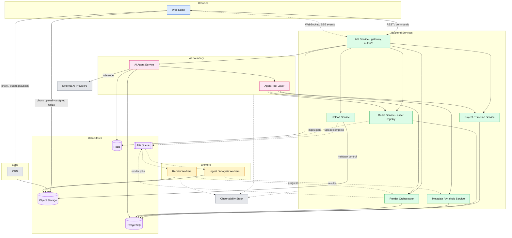

**Key components:** as listed in the diagram. Persistent truth lives in PostgreSQL and Object Storage; Redis holds ephemeral state; the queue carries all long-running work.

**Decision Points**

- Modular monolith vs separate services for the six core backend boxes (the brief warns against unnecessary microservices).
- Which store owns job state: queue, PostgreSQL, or both.
- Whether Metadata/Analysis is a service or only a worker output schema.

---

## 3. Browser Editor Architecture

**Purpose:** Internal structure of the web editor and what is main-thread vs worker.

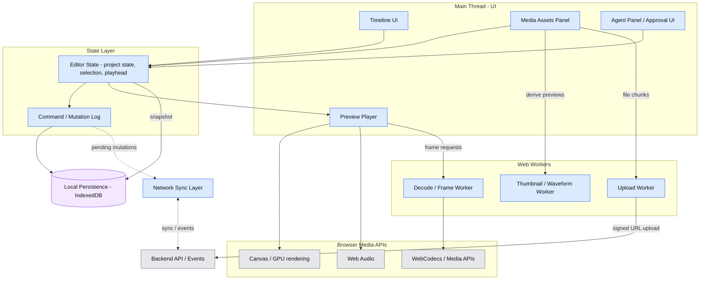

**Key components:** Timeline, Preview Player, Media Assets, Editor State, Local Persistence, Web Workers, Browser Media APIs, rendering/preview layer, Network Sync, project state.

**Decision Points**

- State model: command log vs snapshot vs both.
- Which preview path is canonical: browser decode of proxies, server-rendered preview, or hybrid.
- Where the main-thread / worker boundary sits for state (shared vs message-passed).

---

## 4. Video Processing Pipeline

**Purpose:** Lifecycle of a media asset from upload to final output.

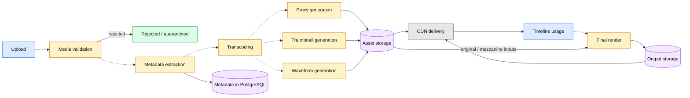

**Key components:** Validation, metadata, transcode, derived artifacts (proxy, thumbs, waveform), asset storage, CDN, final render, output storage.

**Decision Points**

- Are derived-artifact steps a fan-out of independent jobs or one sequential pipeline.
- Whether original media is retained untouched alongside a mezzanine format.
- Where transcript/scene analysis for the agent sits in this pipeline (always-on vs on demand).

---

## 5. Large File Upload Flow

**Purpose:** Resumable chunked upload directly to object storage with server-tracked state.

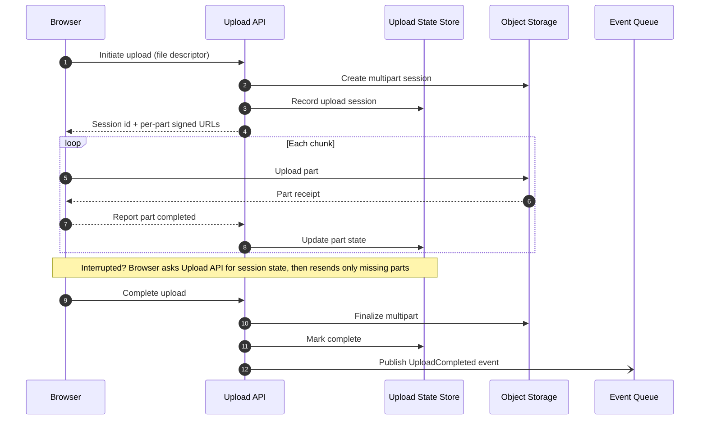

**Key components:** Browser upload logic, Upload API, multipart session, Upload State store, object storage, completion event.

**Decision Points**

- Upload state authority: PostgreSQL, Redis, or object storage's own part listing.
- Chunk size policy and parallelism (fixed vs adaptive).
- Integrity verification: per-part checksum vs whole-file.
- Session expiry and orphan cleanup policy.

---

## 6. Video Rendering Architecture

**Purpose:** From a project definition to a delivered render, including progress and failure paths.

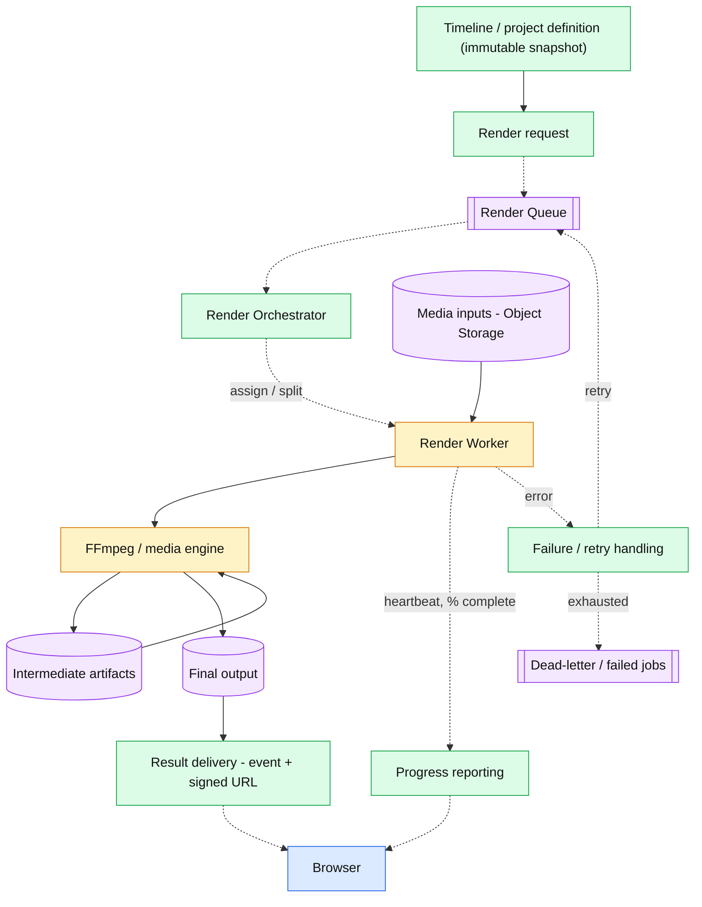

**Key components:** Project snapshot, render request, queue, orchestrator, workers, media engine, intermediate artifacts, output, progress, retry/DLQ, delivery.

**Decision Points**

- Render granularity: whole job per worker vs segmented/parallel with stitch.
- Server-side render only, or also client-side export for small projects.
- Retry policy per failure class (transient vs deterministic).
- Retention of intermediate artifacts for resume.

---

## 7. AI Editing Agent Architecture

**Purpose:** How a natural-language instruction becomes validated, approved timeline changes.

```mermaid
flowchart TB
  classDef br fill:#dbeafe,stroke:#2563eb,color:#111
  classDef be fill:#dcfce7,stroke:#16a34a,color:#111
  classDef ai fill:#fce7f3,stroke:#db2777,color:#111
  classDef ex fill:#e5e7eb,stroke:#6b7280,color:#111
  classDef st fill:#f3e8ff,stroke:#9333ea,color:#111

  UI["User instruction"]:::br
  AG["Agent runtime"]:::ai
  PB{{"Planner / reasoning boundary"}}:::ai
  MPA["Model provider abstraction"]:::ai
  PROV["External model providers"]:::ex
  TOOLS["Tool layer"]:::ai
  subgraph Understanding["Video Understanding"]
    TR["Transcript"]:::be
    SD["Scene detection"]:::be
    FCA["Frame / clip analysis"]:::be
  end
  TM["Timeline manipulation tools"]:::be
  VAL["Validation"]:::be
  HA["Human approval"]:::br
  RR["Render request"]:::be
  PS[("Project state")]:::st

  UI --> AG
  AG --> PB
  PB <-->|"inference"| MPA
  MPA --> PROV
  PB -->|"tool intents"| TOOLS
  TOOLS --> TR
  TOOLS --> SD
  TOOLS --> FCA
  TOOLS --> TM
  TM --> PS
  TM --> VAL
  VAL -->|"fail: feedback"| PB
  VAL -->|"pass"| HA
  HA -->|"reject / revise"| PB
  HA -->|"approve"| RR
  Understanding -->|"results"| PB
```

**Key components:** Agent runtime, planner boundary, provider abstraction, tool layer, video understanding, timeline tools, validation, approval gate, render request.

**Decision Points**

- Where the planner lives (single LLM loop, multi-step planner/executor split, or multi-agent).
- Do agent edits apply to the live project, a branch/draft, or a proposal diff.
- Is human approval required for every change, only before render, or configurable.
- Whether video understanding is precomputed at ingest or lazily invoked by tools.

---

## 8. AI Agent Tool Architecture

**Purpose:** Catalogue of tools, grouped by side-effect class.

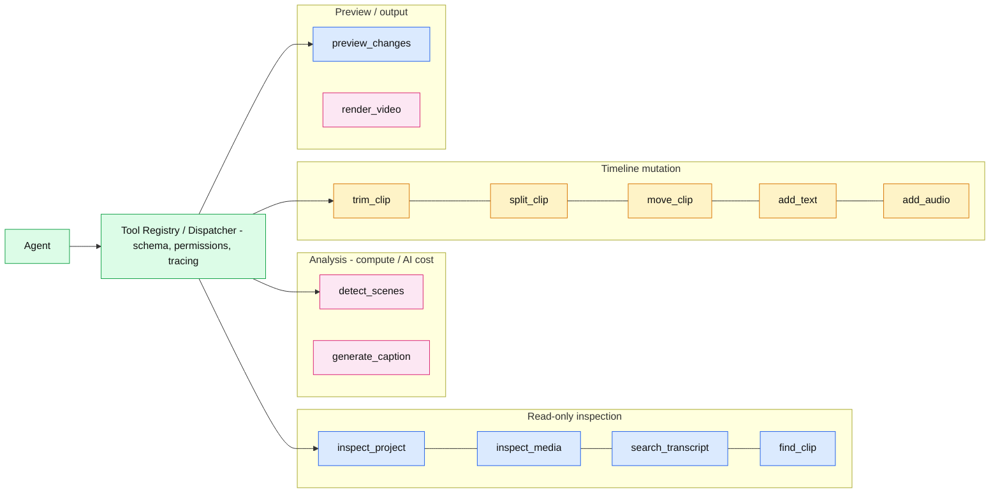

**Key components:** Registry/dispatcher, read-only tools, analysis tools, mutating tools, preview/render tools.

**Decision Points**

- Tool exposure protocol (MCP vs internal function-calling schema).
- Granularity of tools (many primitives vs fewer composite operations).
- Which tools need approval gating (all mutations, only `render_video`).
- Idempotency and undo semantics for each mutating tool.
- Whether `generate_caption` is an analysis tool or a mutation (writes text clips).

---

## 9. AI Agent State Machine

**Purpose:** Lifecycle states of a single agent run.

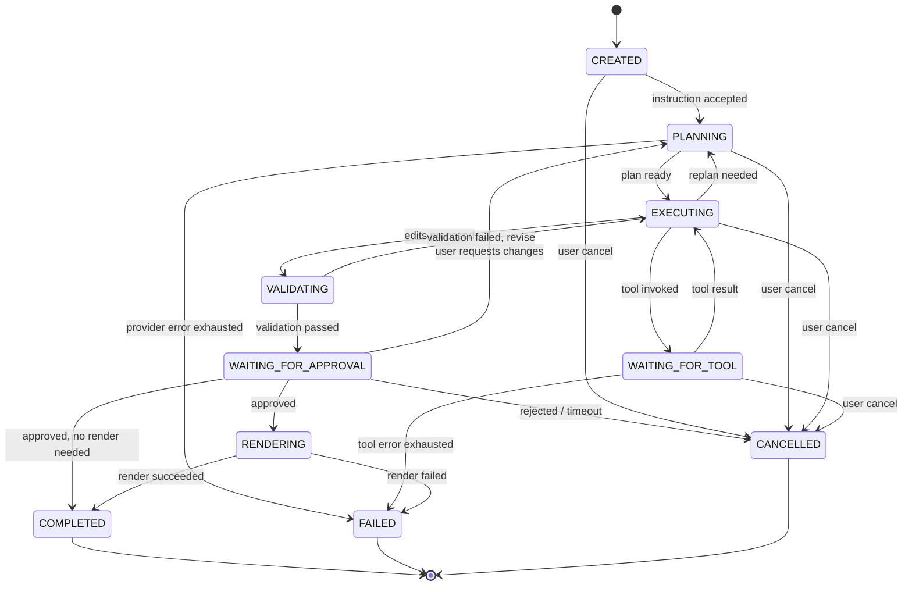

**Key states:** CREATED, PLANNING, EXECUTING, WAITING_FOR_TOOL, VALIDATING, WAITING_FOR_APPROVAL, RENDERING, COMPLETED, FAILED, CANCELLED.

**Decision Points**

- Is state persisted per transition (durable, resumable) or in memory only.
- Bounds on replan/revise loops (max iterations, budget).
- Whether FAILED is terminal or resumable.
- Approval timeout behaviour.
- Is RENDERING part of the agent run or a separate linked Render lifecycle.

---

## 10. Project / Timeline Data Model

**Purpose:** Core persistent entities and their relationships.

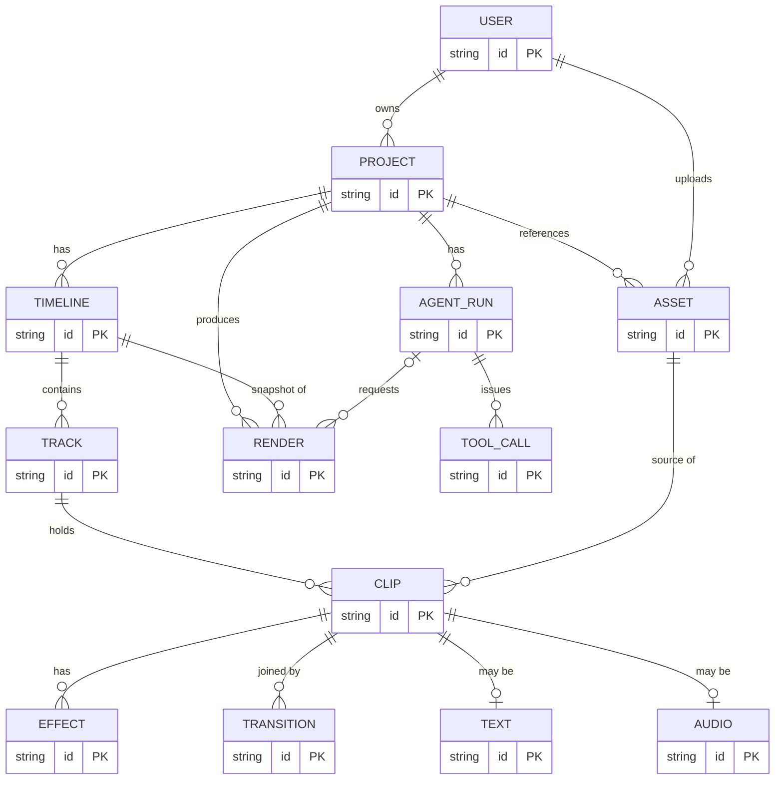

**Key entities:** as listed. Attributes are omitted deliberately; only identities and relationships are in scope.

**Decision Points**

- Timeline as normalized rows vs a versioned document (JSON) per project.
- Text and Audio as separate entities vs clip subtypes.
- Version/revision history: per-edit, per-snapshot, or none.
- Whether Assets are user-scoped, project-scoped, or workspace-scoped (tenancy).

---

## 11. Real-Time Architecture

**Purpose:** Live channels between clients and the backend: state, presence, progress.

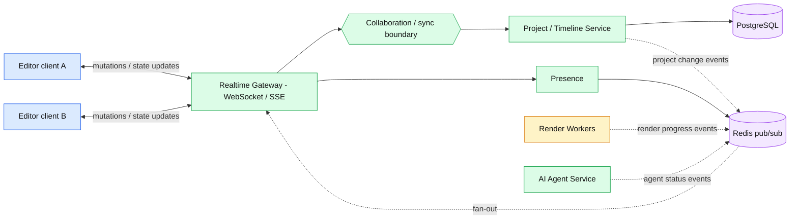

**Key components:** Clients, realtime gateway, sync boundary, presence, pub/sub fan-out, progress/render/agent events.

**Decision Points**

- WebSocket vs SSE (bidirectional vs server-push plus REST).
- Is multi-user collaborative editing in scope at all, or single-editor with multi-device.
- Conflict model if collaborative (see Diagram 12).
- Whether agent edits appear to collaborators live or only after approval.

---

## 12. Offline-First / Local-First Architecture

**Purpose:** What lives locally, how changes sync, and where conflicts can occur.

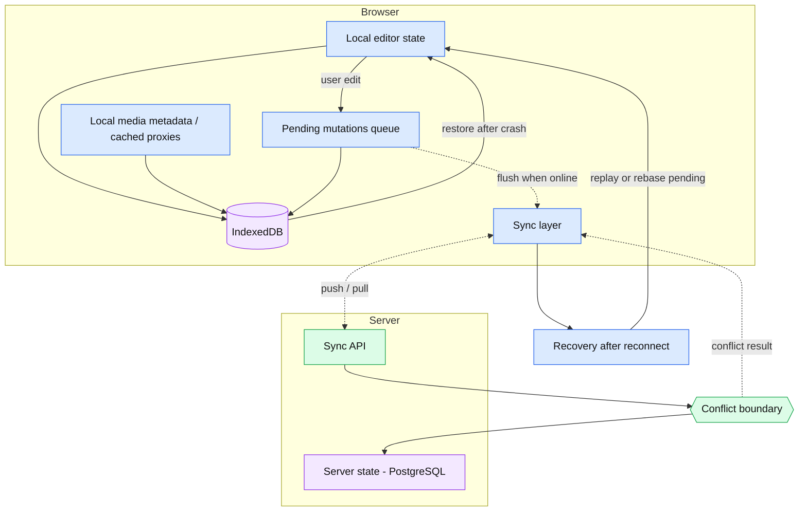

**Key components:** Local state, IndexedDB, local media metadata, pending mutations, sync layer, server state, conflict boundary, reconnect recovery.

**Decision Points**

- Conflict strategy: last-writer-wins, per-field merge, operational transform, or CRDT.
- Whether offline is full local-first (local is source of truth) or cache-with-queue (server is truth).
- Local media policy: store originals locally, proxies only, or references only.
- Storage quota and eviction behaviour.

---

## 13. Performance Architecture

**Purpose:** Where performance pressure arises and which mechanisms address it.

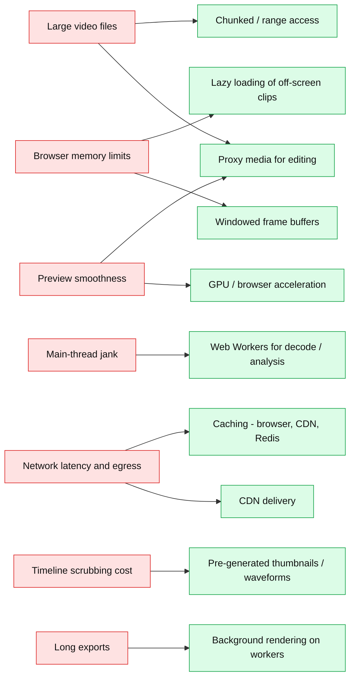

**Key components:** Problem to mechanism mapping across client, network, and backend.

**Decision Points**

- Proxy resolution/codec ladder (single proxy vs multiple renditions).
- Streaming format for preview (progressive file vs segmented streaming).
- Memory budget policy and degradation behaviour on low-end devices.
- Cache invalidation rules when source assets are replaced.

---

## 14. Reliability / Failure Diagram

**Purpose:** Failure domains and the recovery path attached to each.

```mermaid
flowchart TB
  classDef f fill:#fee2e2,stroke:#dc2626,color:#111
  classDef r fill:#dcfce7,stroke:#16a34a,color:#111
  classDef i fill:#fef3c7,stroke:#d97706,color:#111

  F1["Upload failure"]:::f --> R1["Resume from persisted part state"]:::r
  F2["Network interruption"]:::f --> R2["Queue pending mutations, reconnect, resync"]:::r
  F3["Browser crash"]:::f --> R3["Restore from IndexedDB"]:::r
  F4["Worker crash"]:::f --> R4["Lease timeout, job redelivered"]:::r
  F5["Queue failure"]:::f --> R5["Producers retry; durable job record re-enqueues"]:::r
  F6["Render failure"]:::f --> R6["Retry policy, then dead-letter, user notified"]:::r
  F7["AI provider failure"]:::f --> R7["Retry / fallback provider / degrade to manual editing"]:::r
  F8["Database failure"]:::f --> R8["Failover replica, read-only degraded mode"]:::r
  F9["Object-storage failure"]:::f --> R9["Retry with backoff, surface error, no data loss claims"]:::r
  F10["CDN failure"]:::f --> R10["Origin fallback"]:::r

  I1{{"Idempotency: upload part ids"}}:::i -.- R1
  I2{{"Idempotency: mutation ids"}}:::i -.- R2
  I3{{"Idempotency: job id / output key"}}:::i -.- R4
  I4{{"Idempotency: tool-call id"}}:::i -.- R7
```

**Key components:** Ten failure domains, their recovery paths, and four idempotency boundaries (upload parts, client mutations, render jobs, agent tool calls).

**Decision Points**

- Delivery semantics for the queue (at-least-once with idempotent consumers vs stronger).
- RPO/RTO targets for PostgreSQL and object storage.
- Multi-provider fallback policy for AI (cost, quality parity).
- Whether failed agent runs are resumable or restarted.

---

## 15. End-to-End Request Flow

**Purpose:** One complete journey from instruction to playable result.

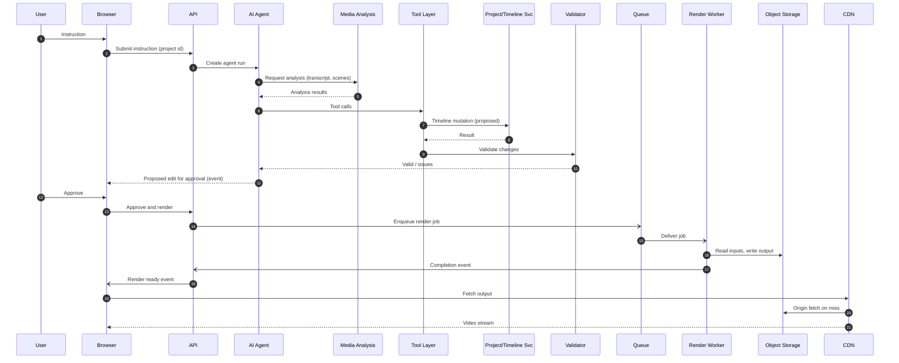

**Key components:** All hops from user to CDN; sync request/response mixed with async events (`-)`).

**Decision Points**

- Does the browser talk to the Agent via API (proxied) or directly over a realtime channel.
- Is analysis run on demand inside the loop or read from precomputed results.
- Where validation sits: inside the tool layer, inside Project Service, or both.

---

## 16. Security Architecture

**Purpose:** Trust boundaries, access control points, and sensitive data handling.

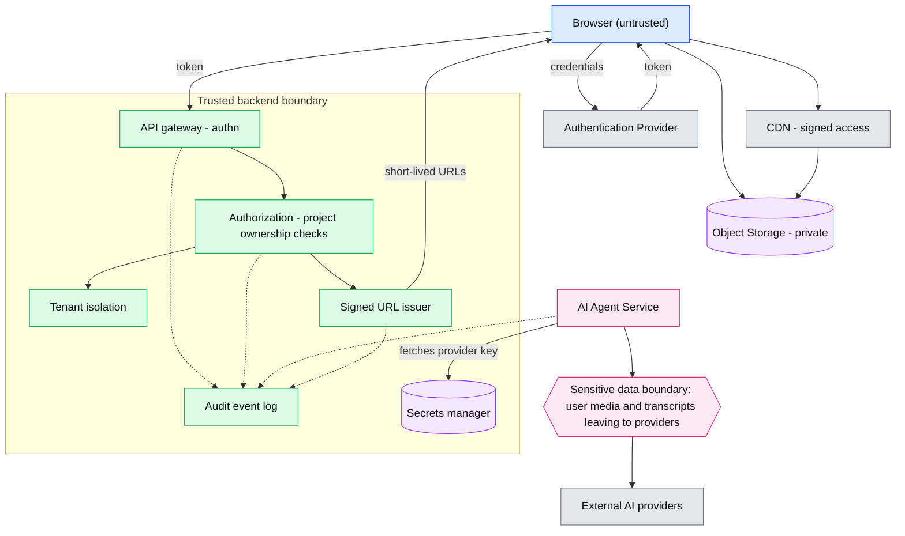

**Key components:** AuthN, AuthZ, ownership, signed URLs, secrets, model credentials, tenant isolation, audit, sensitive-data boundary.

**Decision Points**

- Tenant isolation model: shared schema with row-level scoping, schema-per-tenant, or separate stacks.
- Agent tool authorization: runs with the user's permissions or a scoped service identity.
- Provider data policy: what media/transcript content may be sent externally and retention terms.
- Signed URL lifetime and CDN token strategy.

---

## 17. Observability Architecture

**Purpose:** Telemetry sources, correlation, and the signals they feed.

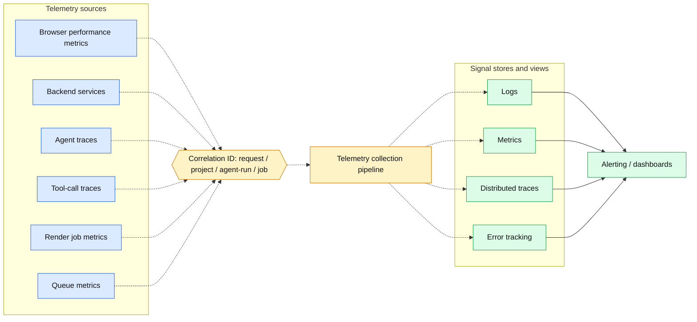

**Key components:** Six source classes, correlation identifiers, collection pipeline, four signal types, alerting.

**Decision Points**

- Trace propagation across async boundaries (queue to worker, agent to tool).
- Storage/retention of agent traces that may contain user content (links to Diagram 16).
- Vendor-neutral instrumentation vs a single vendor stack.
- Sampling policy for browser metrics and traces.

---

## 18. Deployment Architecture

**Purpose:** Production infrastructure layout and network zones.

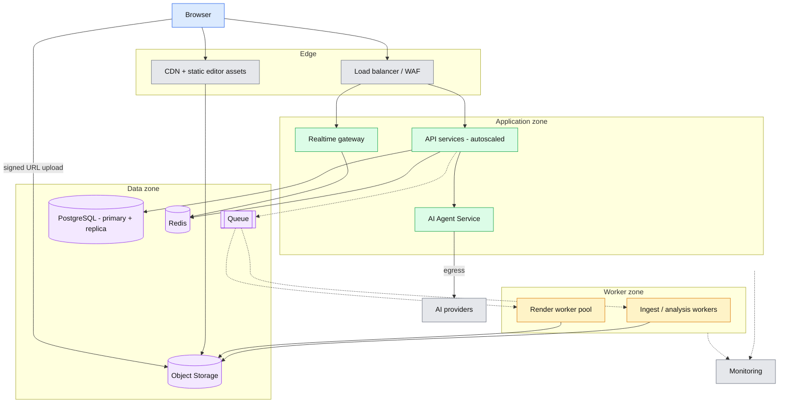

**Key components:** Edge, application zone, worker zone, data zone, external providers, monitoring.

**Decision Points**

- Single cloud vs multi-cloud; managed services vs self-run for queue, DB, Redis.
- Container orchestration vs serverless for each tier (workers especially).
- GPU vs CPU render pools.
- Region strategy and data residency.

---

## 19. Cost / Scaling Architecture

**Purpose:** Scaling dimensions, what each drives, and the cost centre it hits.

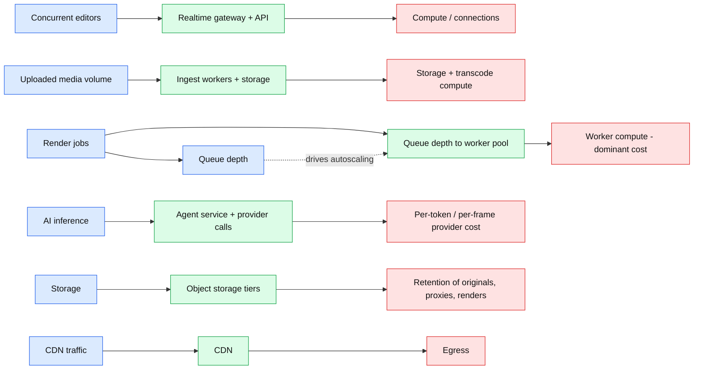

**Key components:** Seven scaling dimensions mapped to the component that absorbs them and the cost they incur.

**Decision Points**

- Autoscaling signal for workers (queue depth, age of oldest job, or both).
- Per-user quotas and fairness across tenants for renders and AI calls.
- Storage lifecycle policy for proxies and old renders.
- Use of spot/preemptible capacity for workers (ties to Diagram 14 retry design).

---

## 20. Technology-to-Component Mapping

**Purpose:** Candidate technologies per responsibility. Entries are candidates, not selections.

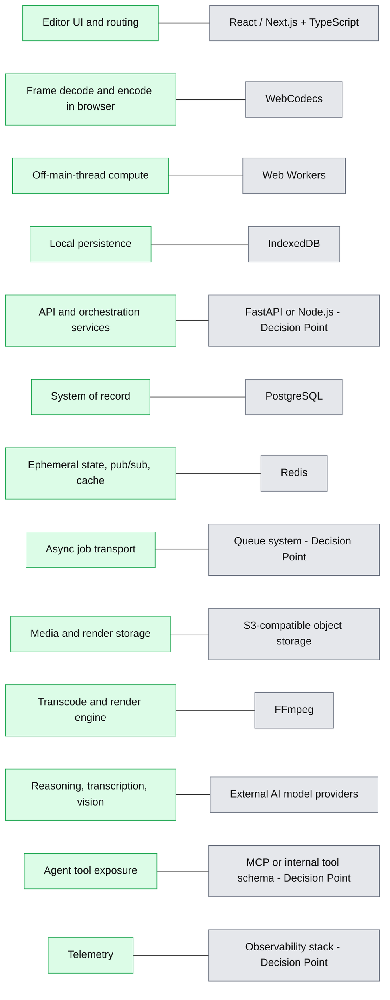

**Key components:** Thirteen responsibilities paired with candidate technologies.

**Decision Points**

- Backend language/runtime (FastAPI vs Node.js) and whether workers share it.
- Queue technology and its delivery guarantees.
- Provider selection and abstraction depth.
- MCP vs internal tool protocol.
- Observability vendor vs self-hosted open stack.

---

## Cross-Cutting Decision Points

1. Collaboration scope: single-editor vs multi-user (affects Diagrams 11, 12, 10).
2. Timeline representation: document vs relational (affects Diagrams 10, 12, 7).
3. Agent autonomy: how much can be applied without human approval (affects 7, 8, 9).
4. Preview strategy: client-side vs server-side vs hybrid (affects 3, 13, 6).
5. Tenancy and data-sharing with external AI providers (affects 16, 17, 7).